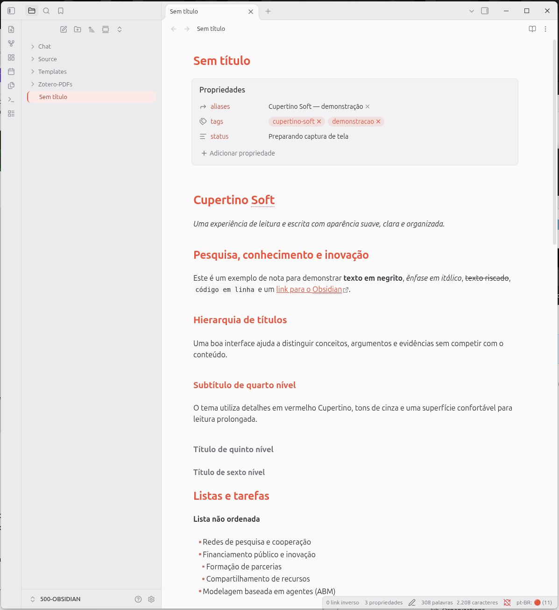
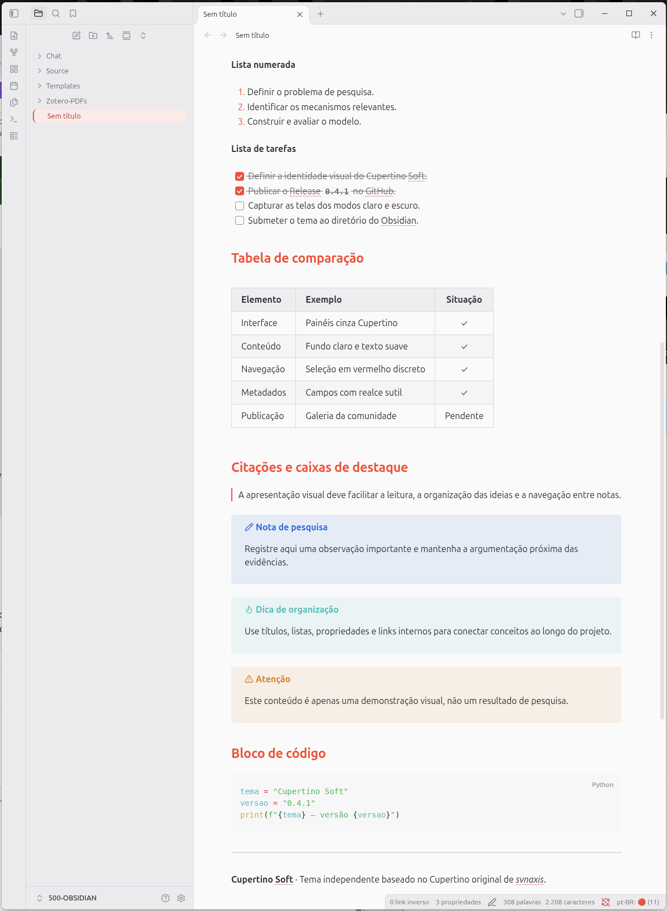

# Cupertino Obsidian Soft Theme

A near-white Obsidian theme with the original Cupertino gray shell (#EBEBED), comfortable #333338 text and bright-but-controlled #FF3B30 red accents.

**Recommended companion:** [Cupertino Zotero Soft Theme](https://github.com/vict0rg/cupertino-zotero-soft-theme), which offers the same Soft Gray background and text color in Zotero's PDF/EPUB reader.

## Screenshots / Capturas de tela

Cupertino Soft em **modo claro**, instalado no Obsidian para Linux. Capturas reais do tema em funcionamento:

| Títulos, propriedades e listas | Tarefas, tabelas, callouts e código |
| --- | --- |
|  |  |

> Os exemplos demonstram o tema em modo claro; o modo escuro ainda precisa de uma captura e validação visual em Linux.

> The in-app theme is named **Cupertino Soft** to follow Obsidian's guidance against redundant “Obsidian” wording in the gallery. Its full GitHub project title is **Cupertino Obsidian Soft Theme**.

## v0.4.1: Spelling underline repair

This maintenance version makes the orange spelling-error **wavy underline explicit**, rather than changing only its color. The previous styling could suppress the native mark on some Chromium/Electron combinations. Text stays `#333338`; only the squiggle is orange. This works in editable text when the native spellchecker reports a spelling error. If underlines remain absent, verify **Settings → Editor → Spellcheck** and the language dictionary using Obsidian's default theme to distinguish a spellcheck-service issue from theme styling.

## v0.4.0: Original gray/red palette and native controls

**Important repair:** the earlier version inherited thousands of lines of Cupertino layout CSS that could hide the Obsidian tab strip, menu/window controls, and side-panel icons on Linux. This version **replaces that layout-heavy source with a small, original, appearance-focused stylesheet**, while preserving Obsidian's own layout and our new gray/red design. Obsidian's built-in layout now handles tabs, ribbons, headings and titlebar button sizing.

Earlier versions remain in the repository's Git history, including the MIT-licensed Cupertino source. v0.4.0 has not yet been visually verified on all Linux desktop environments.

## Consistent Cupertino Soft Gray style

The layout uses Obsidian's own controls, header spacing, native tabs and window buttons. The writing surface is **Soft Gray #FAFAFA** with **#333338** text; sidebars use the original Cupertino **#EBEBED**. Selection uses **#FFE9E8** with a narrow **#FF3B30** stripe. H1–H4 titles use Cupertino red. The metadata/properties area is subtly shaded **#F2F2F4**, with red-tinted field names but normal dark values. Tables resemble statistical grids with 1px borders, gray headers and pale alternating rows.

Our red accents follow the original [Cupertino for Zotero](https://github.com/shenghuang-123/cupertino-for-zotero) system-red color, **#FF3B30**; the selection fill remains pale to avoid overwhelming text.

## Features

- Soft Gray near-white writing surface (`#FAFAFA`), with **no grid**, and original Cupertino `#333338` body text
- Original Cupertino gray sidebars and toolbars `#EBEBED`, thin borders `#D9D9DE`
- H1–H4 headings in original Cupertino red `#FF3B30`; **no long red bars or heading underlines**
- Markdown syntax markers, links, supported citation spans and metadata field names tinted red, without changing note content
- Normal-size Linux titlebar buttons, with a **red close button on hover**
- Light-gray alternating table rows, muted bullets and a coordinated dark mode
- Explicit **orange #FF9500** wavy spelling-error decoration via CSS `::spelling-error`; display still depends on the Obsidian/Electron version and spellcheck settings

Pandoc/Zotero citation plugins may use custom rendering classes, and not all citation spans can be recolored without a plugin-specific selector. The theme does not change stored citations or Markdown.

## Installation

**Linux (Obsidian Flatpak ou .deb):** veja [INSTALL_LINUX.md](INSTALL_LINUX.md) para instalar ou atualizar o Cupertino Soft nas três máquinas, sem alterar suas notas, plugins ou snippets, e para voltar ao tema padrão se necessário.


1. Download [theme.css](https://raw.githubusercontent.com/vict0rg/cupertino-obsidian-soft-theme/main/theme.css) and [manifest.json](https://raw.githubusercontent.com/vict0rg/cupertino-obsidian-soft-theme/main/manifest.json).
2. Put both files in `<your-vault>/.obsidian/themes/Cupertino Soft/`.
3. Open Obsidian **Settings → Appearance → Themes** and choose **Cupertino Soft**.
4. Disable any previously enabled Pixel-Blue / Cupertino color snippets that could conflict.

On Linux, clone or download this repository and run `bash scripts/install-cupertino-soft.sh "/path/to/vault"` to install the theme files.

To return to an older theme, simply choose it in Appearance. The files are separate from your notes.

## Recover the theme without Obsidian menus (Linux)

If a theme has hidden the Settings icon or window menus, **close Obsidian completely** and use the [install-and-activate script](scripts/install-and-activate.sh). It downloads the current `theme.css` and `manifest.json`, creates a dated backup of `.obsidian/appearance.json`, and changes **only** the `cssTheme` setting. Your notes, enabled snippets, plugins and other preferences are preserved.

```bash
curl -fL https://raw.githubusercontent.com/vict0rg/cupertino-obsidian-soft-theme/main/scripts/install-and-activate.sh -o ~/Downloads/obsidian-cupertino-soft-installer.sh
bash ~/Downloads/obsidian-cupertino-soft-installer.sh
```

If you still cannot use the interface, close Obsidian and revert to the standard theme without deleting anything:

```bash
bash ~/Downloads/obsidian-cupertino-soft-installer.sh --reset
```

The default vault path is `~/Dropbox/500-OBSIDIAN`; provide a different vault path as the first argument if needed. The normal Obsidian Settings shortcut is **Ctrl+,** (or Command Palette **Ctrl+P → Open settings**). If existing snippets hide controls independently of the theme, disable those conflicting snippets in Appearance after restoring access.

## Shared visual palette

| Purpose | Color |
| --- | --- |
| Note / PDF/EPUB Soft Gray | `#FAFAFA` |
| Navigation panels | `#EBEBED` |
| Metadata/properties panel | `#F2F2F4` |
| Tabs and toolbars | `#EBEBED` |
| Borders | `#D9D9DE` |
| Alternate table rows | `#F5F5F6` |
| Main text | `#333338` |
| Pale red selection | `#FFE9E8` |
| Cupertino red details | `#FF3B30` |

## Zotero companion

[**Cupertino Zotero Soft Theme**](https://github.com/vict0rg/cupertino-zotero-soft-theme) matches this gray background and the #333338 text color, with a Reading Colors selector supporting named PDF/EPUB Background and Foreground themes. Install both themes for consistent navigation, writing and long-form reading. Each is installed independently.

## Community Themes submission

**This theme is not yet listed in Obsidian → Appearance → Manage.** The [0.4.1 release](https://github.com/vict0rg/cupertino-obsidian-soft-theme/releases/tag/0.4.1) already includes `theme.css` and `manifest.json`, and real screenshots are available above. To appear in Obsidian's gallery, its owner must submit the repository via [Obsidian Community Directory](https://community.obsidian.md); publication depends on Obsidian's review. See [SUBMISSION.md](SUBMISSION.md).

## Attribution and licensing

The repository is a fork of **Cupertino for Obsidian** by [svnaxis](https://github.com/svnaxis/obsidian-cupertino), licensed under **MIT**. Its historical commits and copyright notices remain. Beginning with v0.3.0, the layout-altering upstream CSS has been replaced with a new appearance-only stylesheet instead of continuing to distribute the old UI overrides. The current theme remains MIT-licensed.

Additional design-only references: [Notation](https://github.com/deathau/Notation-for-Obsidian) (The Unlicense), [Typewriter](https://github.com/crashmoney/obsidian-typewriter) (GPL-3.0), [Shimmering Focus](https://github.com/chrisgrieser/shimmering-focus) (MIT), [Olivier's Theme](https://github.com/OlivierPS/Olivier-s-Theme) (MIT), and [Cupertino for Zotero](https://github.com/shenghuang-123/cupertino-for-zotero) (MIT). **No code, fonts, or assets from these design-only references were copied.** See [CREDITS.md](CREDITS.md), [NOTICE.md](NOTICE.md), and [LICENSE](LICENSE).

Independent community project maintained by [vict0rg](https://github.com/vict0rg); not affiliated with Obsidian or upstream developers.
